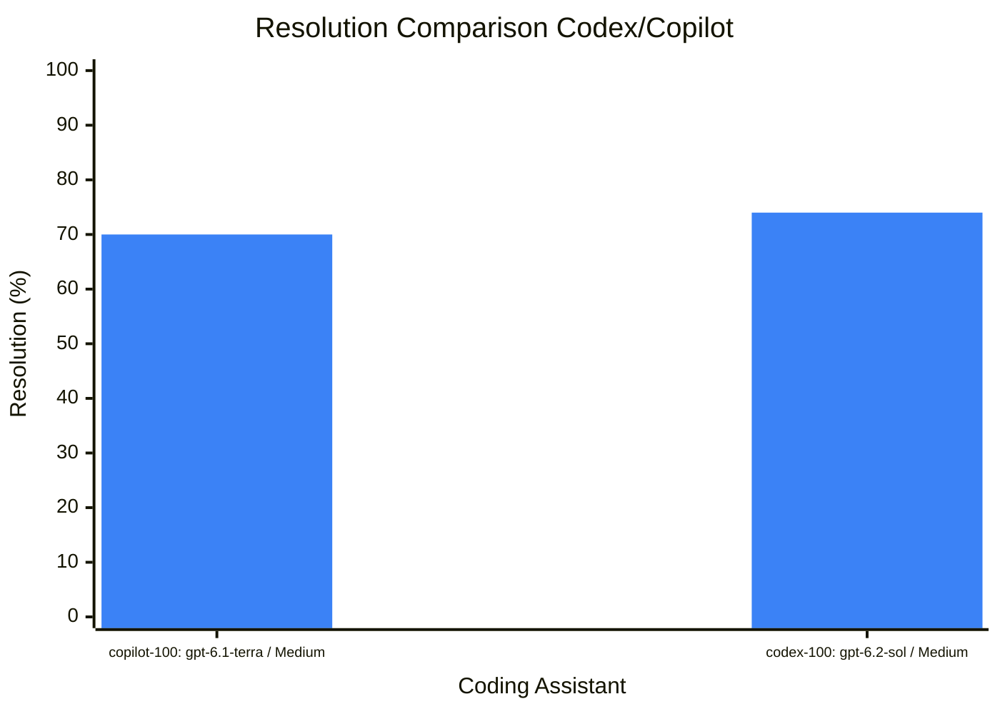

|Test Cases|Coding Assistant|Model|Reasoning|Usage|Resolution %|
|----------|:--------------:|---------|-----|-----|------------|
|SWEBench Lite (300)|Codex|gpt-6.2-sol|Medium| ~64% of weekly quota| Insufficient Resources for Evaluation |
|SWEBench Lite (100)|Codex|gpt-6.2-sol|Medium| ~27% of weekly quota| 74% (74 out of 100)|
|SWEBench Lite (100)|Copilot|gpt-6.1-terra|Medium| 753 AI Credits of monthly quota| 70% (69 out of 99, see note in copilot-100) |



Example evaluation command

```bash
SWEBENCH_EXPERIMENTS_DIR="/Volumes/Extreme SSD/swebench-experiment-results/swebench-experiments"

cd $SWEBENCH_EXPERIMENTS_DIR

swebench eval lite -p "$SWEBENCH_EXPERIMENTS_DIR/runs/codex-lite/predictions.jsonl" --run-id codex-lite --task-repo "$SWEBENCH_EXPERIMENTS_DIR/swe-bench-tasks" -j 6
```


## Results codex-100

```bash
python run_swebench.py --root "$SWEBENCH_EXPERIMENTS_DIR" \
  --assistant codex --run-id codex-100 --model gpt-6.2-sol --reasoning-effort medium \
  --seed 42 --count 100 --generation-workers 4 --evaluation-workers 4
```

Dataset: SWE-bench/SWE-bench_Lite (test split, 300 instances)
Run ID: codex-100
Selected (100): django__django-13551, django__django-11099, matplotlib__matplotlib-25498, matplotlib__matplotlib-23476, django__django-16816, django__django-14382, django__django-13315, sympy__sympy-20442, django__django-12915, sphinx-doc__sphinx-8474, django__django-11422, django__django-11283, django__django-13033, django__django-16408, django__django-17087, sympy__sympy-16792, django__django-11133, django__django-15851, sympy__sympy-23117, sphinx-doc__sphinx-8282, django__django-16527, sympy__sympy-12454, matplotlib__matplotlib-26020, astropy__astropy-14995, django__django-14855, sympy__sympy-22714, pytest-dev__pytest-5692, sympy__sympy-20212, django__django-14752, django__django-16400, pytest-dev__pytest-5413, sympy__sympy-23191, sympy__sympy-21627, scikit-learn__scikit-learn-13497, django__django-13220, pytest-dev__pytest-9359, pytest-dev__pytest-7168, matplotlib__matplotlib-25079, django__django-11797, sympy__sympy-13437, django__django-13768, scikit-learn__scikit-learn-13496, django__django-12708, psf__requests-1963, scikit-learn__scikit-learn-10508, pallets__flask-4045, sympy__sympy-18087, pytest-dev__pytest-7490, django__django-11564, django__django-11049, pytest-dev__pytest-5103, django__django-13590, scikit-learn__scikit-learn-14087, django__django-14580, django__django-11630, sphinx-doc__sphinx-8595, django__django-13658, sphinx-doc__sphinx-8721, django__django-11905, django__django-15789, sympy__sympy-23262, django__django-16873, pylint-dev__pylint-6506, sphinx-doc__sphinx-8273, django__django-15498, django__django-12747, django__django-15695, django__django-15347, django__django-13321, pytest-dev__pytest-5227, django__django-14017, pytest-dev__pytest-7432, sympy__sympy-19254, pylint-dev__pylint-7228, django__django-11583, psf__requests-863, sympy__sympy-13480, django__django-12908, matplotlib__matplotlib-25311, scikit-learn__scikit-learn-10949, django__django-13757, sympy__sympy-13177, django__django-17051, sympy__sympy-13895, django__django-14155, pylint-dev__pylint-7080, sympy__sympy-17655, sympy__sympy-19007, django__django-13448, pytest-dev__pytest-6116, django__django-14997, scikit-learn__scikit-learn-13779, scikit-learn__scikit-learn-14092, django__django-11179, sympy__sympy-14817, django__django-11001, django__django-14787, django__django-15902, sympy__sympy-20322, sympy__sympy-22005

### Run Metadata JSON ([run_metadata.json](./artifacts/codex-100-run-metadata.json))

```
  "run_id": "codex-100",
  "assistant": "codex",
  "model": "gpt-6.2-sol",
  "reasoning_effort": "medium",
  "generation_duration_seconds": 2695.7477529169996,
  "evaluation_duration_seconds": 3730.890994208001
```

### Evaluation Log ([`evaluation.log`](./artifacts/codex-100-evaluation.log))

Summary

```
Total instances: 2294
Instances submitted: 100
Instances completed: 100
Instances incomplete: 2194
Instances resolved: 74
Instances unresolved: 26
Instances with likely infrastructure failures: 0
Instances with ambiguous failures: 0
Instances with empty patches: 0
Instances with errors: 0
Unstopped containers: 0
Unremoved images: 100
Report written to logs/evaluation/codex-100/results.json

```

### Test Case Results JSON

Over all summary of the 100 test cases: [`results.json](./artifacts/codex-100-results.json)

- Example of **resolved** test case ["matplotlib__matplotlib-23476"](./artifacts/codex-100-test-case-resolved-example.json)

- Example of **unresolved** test case ["scikit-learn__scikit-learn-10508"](./artifacts/codex-100-test-case-unresolved-example.json)


## Results copilot-100

Starting at 668 out of 1500 AI Credits (Pro Plan) end with 1,421 credits consumed for patch generation.  Consumed 753 credits for patch generation.

```bash
python run_swebench.py --root "$SWEBENCH_EXPERIMENTS_DIR" \
  --assistant copilot --run-id copilot-100 --model gpt-6.1-terra --reasoning-effort medium \
  --seed 42 --count 100 --generation-workers 4 --evaluation-workers 4
```

```
Dataset: SWE-bench/SWE-bench_Lite (test split, 300 instances)
Run ID: copilot-100
Selected (100): django__django-13551, django__django-11099, matplotlib__matplotlib-25498, matplotlib__matplotlib-23476, django__django-16816, django__django-14382, django__django-13315, sympy__sympy-20442, django__django-12915, sphinx-doc__sphinx-8474, django__django-11422, django__django-11283, django__django-13033, django__django-16408, django__django-17087, sympy__sympy-16792, django__django-11133, django__django-15851, sympy__sympy-23117, sphinx-doc__sphinx-8282, django__django-16527, sympy__sympy-12454, matplotlib__matplotlib-26020, astropy__astropy-14995, django__django-14855, sympy__sympy-22714, pytest-dev__pytest-5692, sympy__sympy-20212, django__django-14752, django__django-16400, pytest-dev__pytest-5413, sympy__sympy-23191, sympy__sympy-21627, scikit-learn__scikit-learn-13497, django__django-13220, pytest-dev__pytest-9359, pytest-dev__pytest-7168, matplotlib__matplotlib-25079, django__django-11797, sympy__sympy-13437, django__django-13768, scikit-learn__scikit-learn-13496, django__django-12708, psf__requests-1963, scikit-learn__scikit-learn-10508, pallets__flask-4045, sympy__sympy-18087, pytest-dev__pytest-7490, django__django-11564, django__django-11049, pytest-dev__pytest-5103, django__django-13590, scikit-learn__scikit-learn-14087, django__django-14580, django__django-11630, sphinx-doc__sphinx-8595, django__django-13658, sphinx-doc__sphinx-8721, django__django-11905, django__django-15789, sympy__sympy-23262, django__django-16873, pylint-dev__pylint-6506, sphinx-doc__sphinx-8273, django__django-15498, django__django-12747, django__django-15695, django__django-15347, django__django-13321, pytest-dev__pytest-5227, django__django-14017, pytest-dev__pytest-7432, sympy__sympy-19254, pylint-dev__pylint-7228, django__django-11583, psf__requests-863, sympy__sympy-13480, django__django-12908, matplotlib__matplotlib-25311, scikit-learn__scikit-learn-10949, django__django-13757, sympy__sympy-13177, django__django-17051, sympy__sympy-13895, django__django-14155, pylint-dev__pylint-7080, sympy__sympy-17655, sympy__sympy-19007, django__django-13448, pytest-dev__pytest-6116, django__django-14997, scikit-learn__scikit-learn-13779, scikit-learn__scikit-learn-14092, django__django-11179, sympy__sympy-14817, django__django-11001, django__django-14787, django__django-15902, sympy__sympy-20322, sympy__sympy-22005
```

**Note:** Test case `sphinx-doc__sphinx-8474` did not generate a patch file and was not evaluated.  Therefore only 99 test cases were evaluated.

> sphinx-doc__sphinx-8474 stopped at patch generation. Copilot exited successfully with zero files modified, leaving
> model.patch empty. The run recorded generation_failed with the error “Copilot produced no patch,” so the case was
> never submitted for evaluation. Generation status (/Volumes/Extreme SSD/swebench-experiment-results/swebench-
> experiments/runs/copilot-100/generation_status.json:48) · Copilot exit record (/Volumes/Extreme SSD/swebench-
> experiment-results/swebench-experiments/runs/copilot-100/sphinx-doc__sphinx-8474/copilot.jsonl:3946)
>
> Copilot chose to leave the code unchanged because it couldn’t reproduce an incorrect warning. It concluded that Sphinx
> 3.3 intentionally warns when :numref: references an uncaptioned table, and it reported that the existing singlehtml
> and LaTeX numbering tests passed. Copilot’s final assessment (/Volumes/Extreme SSD/swebench-experiment-results/
> swebench-experiments/runs/copilot-100/sphinx-doc__sphinx-8474/copilot.jsonl:3852)


### Run Metadata JSON ([run_metadata.json](./artifacts/copilot-100-run-metadata.json))

```
  "run_id": "copilot-100",
  "assistant": "copilot",
  "model": "gpt-6.1-terra",
  "reasoning_effort": "medium",
  "generation_duration_seconds": 2617.763778790999,
  "evaluation_duration_seconds": 3626.8498597080015
```

### Evaluation Log ([`evaluation.log`](./artifacts/copilot-100-evaluation.log))

Summary

```
Total instances: 2294
Instances submitted: 99
Instances completed: 99
Instances incomplete: 2195
Instances resolved: 69
Instances unresolved: 30
Instances with likely infrastructure failures: 0
Instances with ambiguous failures: 2
Instances with empty patches: 0
Instances with errors: 0
Unstopped containers: 0
Unremoved images: 100
Report written to logs/evaluation/copilot-100/results.json
```

### Test Case Results JSON

Overall summary of the 100 test cases in [`results.json`](./artifacts/copilot-100-results.json).

- Example of a **resolved** test case ["scikit-learn__scikit-learn-13496"](./artifacts/copilot-100-test-case-resolved-example.json)
- Example of an **unresolved** test case ["pylint-dev__pylint-6506"](./artifacts/copilot-100-test-case-unresolved-example.json)
