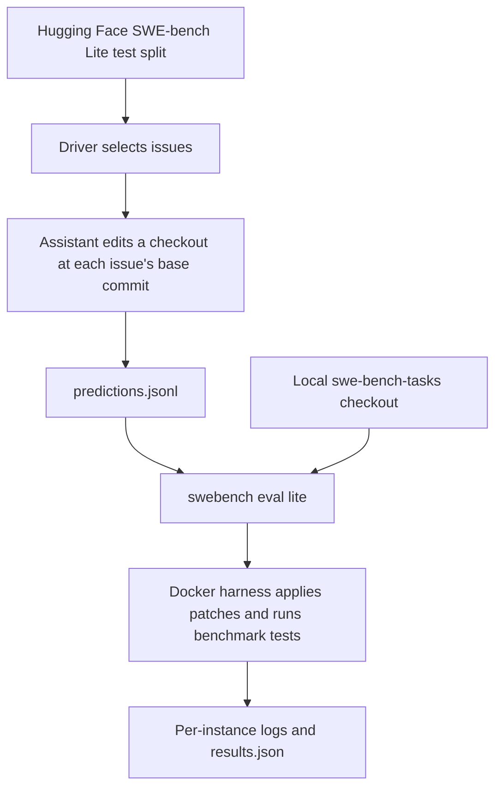

# SWE-bench Lite workflow

[run_swebench.py](../run_swebench.py) generates patches with Codex or GitHub Copilot, then hands those patches to the SWE-bench CLI for evaluation in Docker. Generation uses the Hugging Face SWE-bench Lite test split to select issues. Evaluation uses the task metadata and Docker build definitions in the local `swe-bench-tasks` checkout. The instance ID connects the issue, patch, and evaluation result.



## Patch generation

1. The driver selects the assistant adapter and loads the Lite test split. It uses explicit `--ids`, a sample without replacement based on `--count` and `--seed`, or the entire split in dataset order when `--count 0` is supplied.
2. For each selected issue, a generation worker creates a workspace under `<root>/runs/<run-id>/<instance-id>/` and saves the issue metadata and prompt. It uses `git clone` to copy the issue's open-source project from GitHub, then uses `git checkout --detach` to switch the clone to the exact commit predetermined by the benchmark's `base_commit` field. The worker verifies that `HEAD` matches that commit before the [Codex](../assistants/codex.py) or [Copilot](../assistants/copilot.py) adapter runs its CLI in the clone and leaves its changes in the working tree.
3. The driver checks the diff and writes `model.patch`. It records the outcome for every selected issue in `generation_status.json` and writes one JSONL row per successful patch to `predictions.jsonl` in selection order. Each row contains `instance_id`, `model_name_or_path`, and `model_patch`. Empty patches and other generation failures are recorded in the status file and omitted from the predictions.

`--dry-run` stops after printing the selection. `--skip-eval` stops after generation. With `--skip-generation --run-id <run-id>`, the driver validates the saved predictions and proceeds directly to evaluation. `--generation-workers` and `--evaluation-workers` control concurrency in their respective stages.

## Evaluation in the SWE-bench checkout

Each SWE-bench instance represents one issue and can run several individual tests. Its Docker image packages the project revision and the dependencies needed to reproduce that issue's test environment. Those requirements can vary across projects and revisions. The harness starts a container from the image, applies the assistant's patch inside it, and runs the benchmark tests there. This gives each evaluation a consistent starting environment and isolates changes made during the test run.

The driver invokes the installed `swebench` executable from `--swebench-dir` (default `<root>/SWE-bench`). The module paths below are relative to the `swebench/` package in the sibling checkout `../SWE-bench`. The command uses the executable on `PATH`, so that installation must point at the intended SWE-bench version.

```bash
swebench eval lite -p <predictions.jsonl> --run-id <run-id> \
  --task-repo <task-repo> -j <evaluation-workers>
```

| Step | SWE-bench modules | Role |
| --- | --- | --- |
| Dispatch | `cli/cli.py`, `cli/evaluate.py`, `cli/_datasets.py` | Register the CLI, resolve the `lite` dataset alias, and pass the predictions and test split to the harness. |
| Match predictions | `harness/run_evaluation.py`, `harness/utils.py`, `task/repo.py` | Read the predictions, match submitted IDs to test-split tasks from the local task repository, and turn task metadata into test specifications. |
| Prepare images | `task/repo.py`, `image_builder/prepare_images.py`, `image_builder/image_spec.py`, `image_builder/docker_build.py` | Locate the task Dockerfiles and build contexts, construct image specifications, and build the required images. The harness attempts to pull a published image if the expected image is missing after the build. |
| Execute tests | `harness/run_evaluation.py`, `harness/docker_utils.py` | Start an instance container, apply the submitted patch, and run the task's evaluation script with a timeout. The script sets up the benchmark tests and runs them in the container. |
| Grade and report | `harness/grading.py`, `harness/log_parsers/`, `harness/reporting.py` | Parse test output and check that the expected `FAIL_TO_PASS` tests now pass and the `PASS_TO_PASS` tests still pass. Write the per-instance verdicts and aggregate results. |

## Where to find the outcome

- **Driver artifacts** live in `<root>/runs/<run-id>/`. Use `generation_status.json` to see which issues produced patches, `evaluation.log` for the streamed CLI output, and `run_metadata.json` for the assistant settings and generation and evaluation durations recorded by a generation run.
- **Harness artifacts** live in `<swebench-dir>/logs/evaluation/<run-id>/`. Use `results.json` for the aggregate counts and the per-instance logs and reports to diagnose patch application, test execution, and grading. The harness can reuse saved reports when the same run ID is used again.

The driver evaluates available predictions even when some generation attempts fail. In a generation run, it returns a nonzero exit code if any selected issue fails to produce a patch or if the evaluation command fails. Use the harness report to see which submitted patches resolved their issues.
